<div align="center">

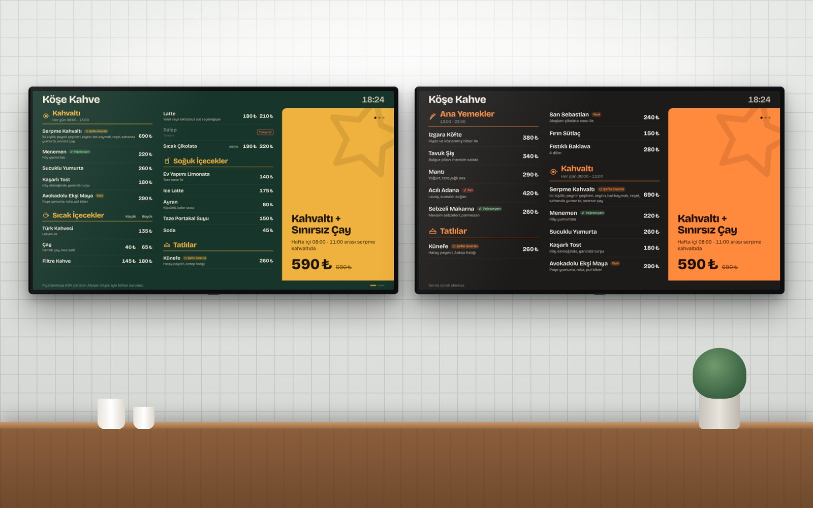

# WD Dijital Menü

**Kafe ve restoranlar için TV menü panosu: fiyatı panelden değiştirin, ekranda anında görünsün.**<br>
**A TV menu board for cafés and restaurants: change a price in the panel and it shows on screen instantly.**

[](https://www.php.net)
[](#kurulum)
[](#ekranlar)
[](LICENSE)
[](#lisans)

[**Türkçe**](#türkçe) · [**English**](#english)

Geliştirici / Developer: **[Web Danışmanı](https://webdanismani.com)**<br>
Destek / Support: **[oblifex.com](https://oblifex.com)** webmaster destek forumu / webmaster support forum

</div>

---

<a id="türkçe"></a>

## Türkçe

### Nedir?

WD Dijital Menü, kafenizin veya restoranınızın TV'lerini dijital menü panosuna çeviren ücretsiz bir yazılımdır. Ürünleri, fiyatları ve kampanyaları yönetim panelinden girersiniz; TV'deki menü en geç 30 saniye içinde kendini günceller. Basılı menü değiştirmek, tabela yaptırmak ya da aylık abonelik ödemek gerekmez.

Kendi hostinginize kurulur. Akıllı TV'nin tarayıcısı, Android TV kutusu veya bir Raspberry Pi yeterlidir.

### Özellikler

- **Kategoriler ve ürünler:** Açıklama, görsel, eski fiyat (üstü çizili) ve etiketler: yeni, şefin önerisi, acı, vejetaryen, vegan, glutensiz.
- **Boy seçenekleri:** Küçük / Büyük, Tek / Duble gibi en çok üç fiyat sütunu; başlıklar menüde otomatik hizalanır.
- **Tükendi düğmesi:** Ürünü tek tıkla "Tükendi" yapın; fiyat gizlenir, panodan tek tıkla yeniden satışa açılır.
- **Toplu fiyat güncelleme:** Seçtiğiniz kategorilere yüzde veya tutar olarak zam ya da indirim, 5 veya 10'a yuvarlama. Uygulamadan önce eski ve yeni fiyatların listesini görürsünüz.
- **Kampanyalar:** Menünün yanında veya tam ekran dönen slaytlar. Gün, saat ve tarih aralığı verilebilir (ör. hafta içi 15:00-18:00); gece yarısını aşan saatler desteklenir. Görsel veya renkli arka plan.
- **Çoklu ekran:** Her TV için ayrı ekran ve adres: biri kahvaltıyı, diğeri içecekleri veya yalnızca kampanyaları gösterebilir.
- **Akıllı yerleşim:** Menü sütunlara kendiliğinden dağılır. Sığmazsa önce biraz küçültülür, yine sığmazsa sayfalara bölünüp sırayla gösterilir; boş yer kalırsa yazılar büyütülür.
- **3 tema:** Bistro (koyu yeşil), Gece (koyu, turuncu vurgulu) ve Beyaz. Logonuzu ekleyebilirsiniz.
- **Yatay ve dikey ekran** desteği.
- **İnternet kesintisine dayanıklı:** Bağlantı koparsa ekran son menüyü göstermeye devam eder.
- **Güvenli görsel yükleme:** Yalnızca gerçek JPG/PNG/WebP kabul edilir; yükleme klasöründe betik çalıştırılmaz.
- **Örnek menü:** Kurulumda örnek bir kafe menüsü gelir; tek tıkla silinir.
- **Türkçe ve İngilizce** panel, açık/koyu tema, mobil uyumlu (fiyatları telefondan güncelleyebilirsiniz).

### Ekran görüntüleri

| Bistro teması (menü + kampanya) | Gece teması |
|---|---|
| 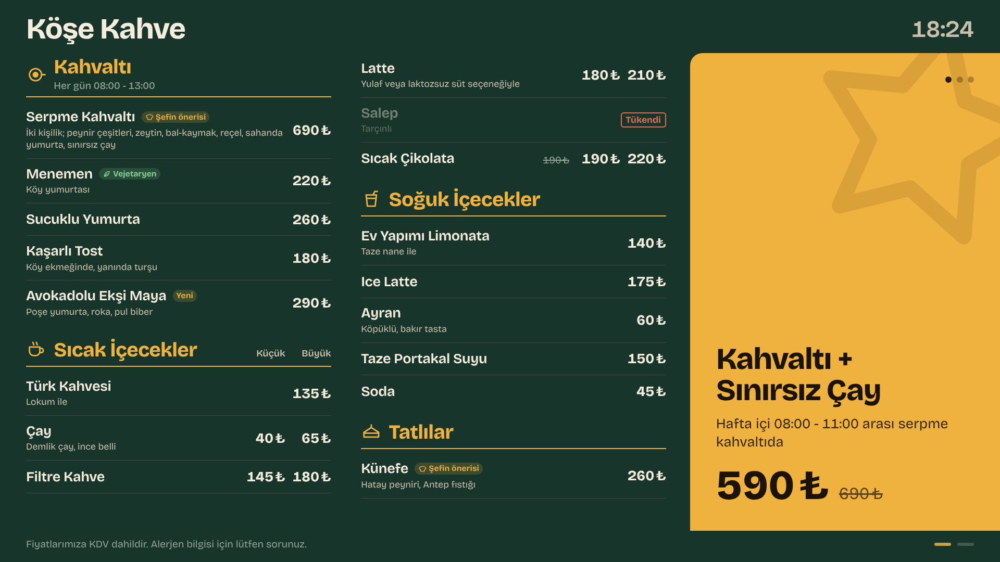 | 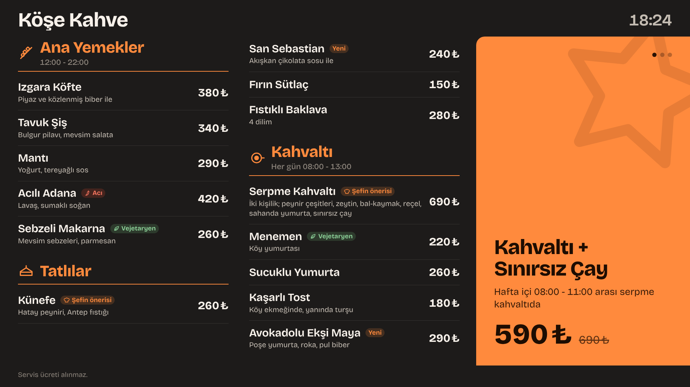 |

| Beyaz tema (yalnız menü) | Tam ekran kampanya |
|---|---|
| 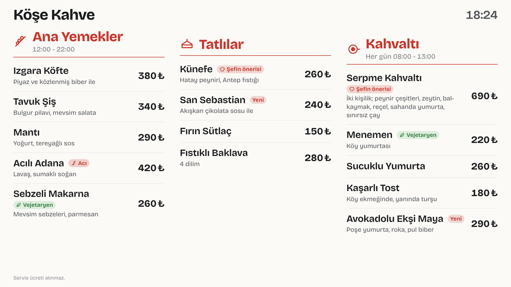 | 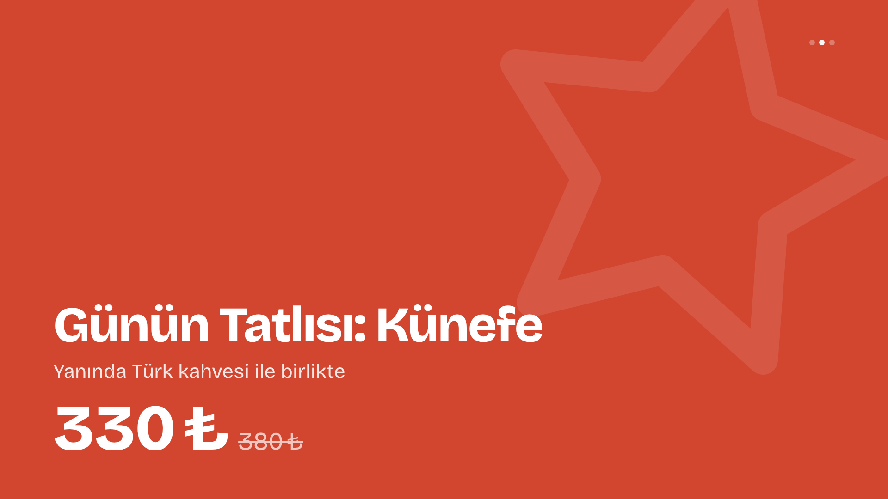 |

| Dikey ve yatay ekranlar | Dikey ekran |
|---|---|
| 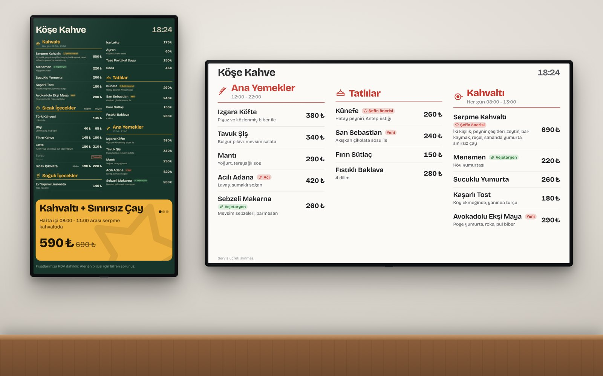 | 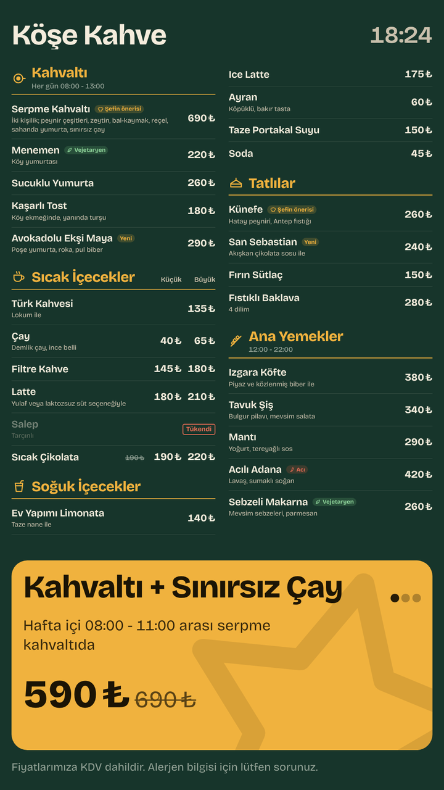 |

| Pano | Ürünler ve hızlı fiyat düzenleme |
|---|---|
| 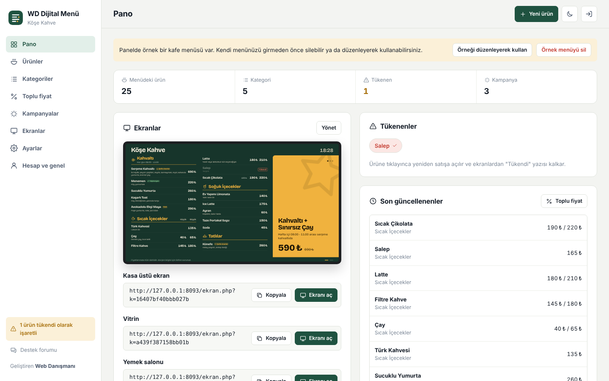 | 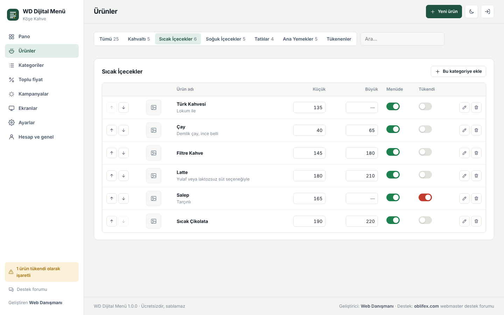 |

| Toplu fiyat güncelleme | Kampanya |
|---|---|
| 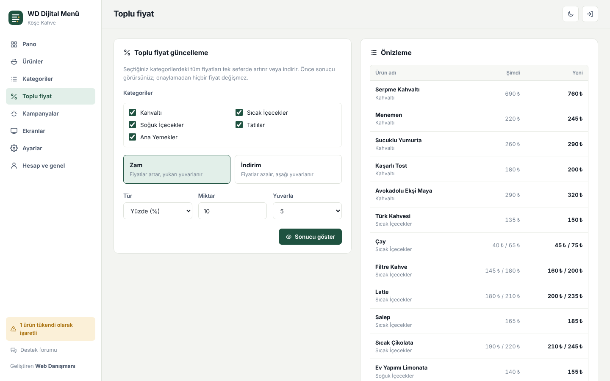 | 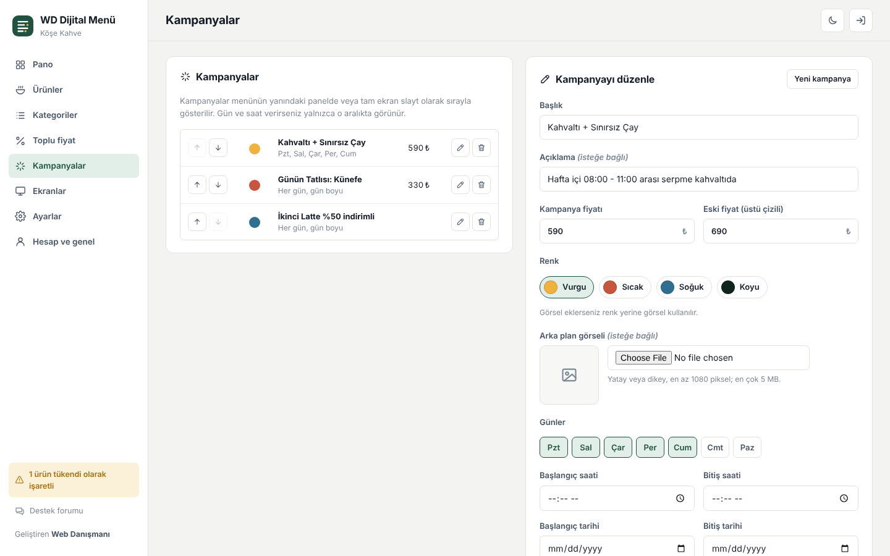 |

| Ekranlar (koyu panel) |
|---|
| 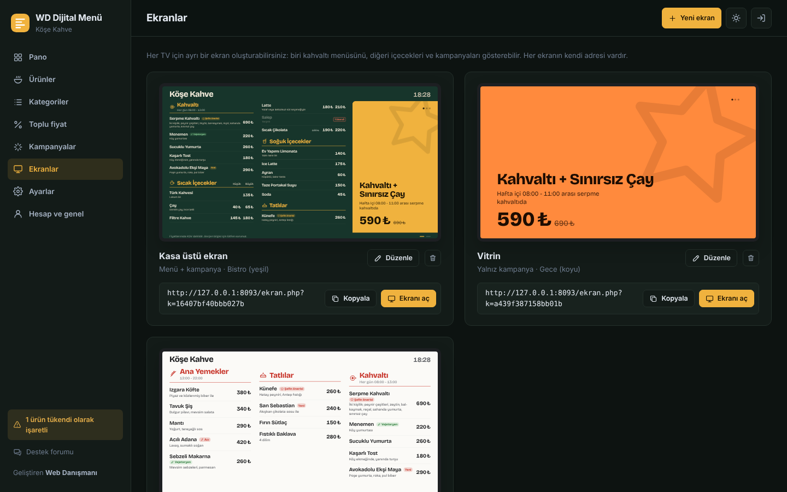 |

<a id="kurulum"></a>

### Kurulum

**Gereksinimler:** PHP 8.0 veya üstü, PDO (SQLite veya MySQL), mbstring. Görsel yüklemek için `uploads/` klasörü yazılabilir olmalı.

1. [Releases](../../releases) sayfasından `wd-dijital-menu.zip` dosyasını indirin.
2. Dosyaları hostinginize yükleyin (ör. `menu.siteniz.com` alt alan adına veya `/menu` klasörüne).
3. Tarayıcıda adresi açın; kurulum sihirbazında veritabanını seçin, işletme adını ve yönetici hesabını girin.
4. Örnek menüyü silin veya düzenleyin, ardından **Ekranlar** sayfasındaki adresi TV'de açın.

> `data/` klasörü veritabanını tutar; Apache ve LiteSpeed'de `.htaccess` ile korunur. **Nginx** için:
> ```nginx
> location ~ ^/(data|app|lang)/ { deny all; }
> location ~ ^/uploads/.*\.(php|phtml|phar)$ { deny all; }
> ```

<a id="ekranlar"></a>

### Ekranlar

| Görünüm | Ne gösterir? |
|---|---|
| **Menü + kampanya** | Solda menü, sağda dönen kampanyalar. Kasa üstü için ideal. |
| **Yalnız menü** | Tüm ekran menü; seçtiğiniz kategorilerle. |
| **Yalnız kampanya** | Tam ekran slaytlar. Vitrin veya giriş için. |

Her ekranın kategorileri, teması, sütun sayısı, sayfa ve slayt süreleri ayrıdır. TV'de açmak için: akıllı TV tarayıcısı, Android TV kutusunda Fully Kiosk Browser gibi bir kiosk uygulaması veya Raspberry Pi'de `chromium --kiosk "ekran adresi"`.

### Güncelleme

`data/` ve `uploads/` klasörleri dışındaki dosyaları yeni sürümle değiştirin. Menünüz, görselleriniz ve ayarlarınız korunur.

### Destek

Sorularınız, hata bildirimleriniz ve önerileriniz için **[oblifex.com](https://oblifex.com) webmaster destek forumunu** kullanın.

Kurulum, ekran ve kiosk yapılandırması veya özel geliştirme için: **[webdanismani.com](https://webdanismani.com)**

<a id="lisans"></a>

### Lisans

Bu yazılım **ücretsiz paylaşılır ve satılamaz.** [CC BY-NC-SA 4.0](LICENSE) lisansıyla yayınlanmıştır.

- Ücretsiz indirebilir, kendi işletmenizde ve müşterilerinizin işletmelerinde kullanabilirsiniz.
- Değiştirebilirsiniz; değiştirilmiş sürümü aynı lisansla ve Web Danışmanı'nı kaynak göstererek paylaşmanız gerekir.
- Yazılımı veya değiştirilmiş bir sürümünü **satamazsınız**, ücretli bir pakete veya hizmete ekleyerek **dağıtamazsınız**.

Yazı tipi (Bricolage Grotesque) SIL Open Font License 1.1 ile dağıtılır. Örnek menüdeki işletme ve ürünler kurgusaldır.

---

<a id="english"></a>

## English

### What is it?

WD Dijital Menü turns the TVs in your café or restaurant into a digital menu board. You manage products, prices and promotions in the admin panel, and the menu on the TV updates itself within 30 seconds. No reprinting menus, no signage orders, no monthly subscription.

It installs on your own hosting. A smart TV browser, an Android TV box or a Raspberry Pi is enough. The screen texts are in Turkish; the admin panel is available in Turkish and English, and the currency symbol is configurable.

### Features

- **Categories and products** with description, image, old (struck-through) price and labels: new, chef's pick, spicy, vegetarian, vegan, gluten-free.
- **Size options:** up to three price columns such as Small / Large or Single / Double, aligned automatically.
- **Sold-out switch:** one click hides the price and shows "Sold out"; one click on the dashboard puts it back on sale.
- **Bulk price update:** raise or lower prices in selected categories by percent or amount, with rounding to 5 or 10. You see old and new prices before applying.
- **Promotions:** rotating slides next to the menu or full screen, with days, hours and date ranges (overnight hours supported), image or colour background.
- **Multiple screens:** a separate screen and address for each TV — breakfast on one, drinks or promotions on another.
- **Smart layout:** the menu flows into columns; if it does not fit it is scaled down slightly, then split into rotating pages; spare space makes the text larger.
- **3 themes** (Bistro, Night, White) and your own logo. **Landscape and portrait** screens.
- **Resilient:** if the connection drops, the screen keeps showing the last menu.
- **Safe uploads:** only real JPG/PNG/WebP files; scripts never run in the upload folder.
- **Sample menu** on install, removable in one click. **Turkish and English** panel, light/dark theme, mobile friendly.

### Installation

**Requirements:** PHP 8.0+, PDO (SQLite or MySQL), mbstring; `uploads/` must be writable for images.

1. Download `wd-dijital-menu.zip` from [Releases](../../releases).
2. Upload the files to your hosting (e.g. `menu.example.com` or a `/menu` folder).
3. Open the address, choose the database and create your admin account in the setup wizard.
4. Delete or edit the sample menu, then open the address from the **Screens** page on the TV.

On **Nginx**, deny `^/(data|app|lang)/` and PHP files under `^/uploads/`.

### Updating

Replace every file except the `data/` and `uploads/` folders. Your menu, images and settings are kept.

### Support

Use the **[oblifex.com](https://oblifex.com) webmaster support forum** for questions, bug reports and suggestions. For setup, kiosk configuration or custom development: **[webdanismani.com](https://webdanismani.com)**

### License

This software is **free and may not be sold.** Released under [CC BY-NC-SA 4.0](LICENSE): you may use it in your own and your clients' businesses and modify it; modified versions must be shared under the same license with credit to Web Danışmanı. Selling it or bundling it into a paid package or service is prohibited.

The font (Bricolage Grotesque) is distributed under the SIL Open Font License 1.1. The business and products in the sample menu are fictional.
